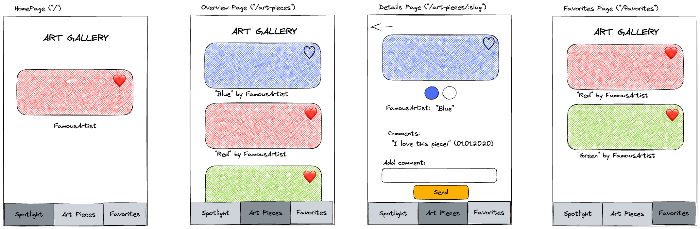

# Recap Project 6: Art Gallery App with a Coding Agent

In this project, you will create an interactive art gallery app with React, TypeScript and React Router: the same app as in Recap Project 5, but this time a coding agent (Claude Code) writes all of the code, including the tests, the configuration and the workflows. You plan, steer, check and review.

This is an individual project: create your own **public** repository following this [guide to setup your repository](./docs/github-respository-template.md). Then follow the steps in the project brief of Recap Project 6 in your curriculum.

## Overview

We will create an art gallery app with four pages: **Spotlight**, **Gallery**, **Favorites** and **Details**. Users can like or unlike art pieces, and liked pieces appear on the **Favorites** page. Users can also comment on art pieces. As a bonus, favorites and comments are saved in the browser.



To open the wireframes file `wireframes.excalidraw.png` in VS Code, install the [excalidraw extension](https://marketplace.visualstudio.com/items?itemName=pomdtr.excalidraw-editor).

## User Stories

The user stories are the issues of your repository. There are 13 issues: the 10 user stories (8 core stories and 2 bonus stories) and three setup issues (1 to 3). The user stories are issues 4 to 13. Each issue contains a value proposition, acceptance criteria, tasks and, for some issues, a hint. Start with the setup issues 1, 2 and 3, then work on the user stories 4 to 13 in the order of their numbers.

## API

We fetch all necessary information about the art pieces from an API specifically designed for this course. [Check out the API](https://example-apis.vercel.app/api/art).

```bash
https://example-apis.vercel.app/api/art
```

An art piece looks like this. The Gallery Page story (issue 4) defines a TypeScript type for it:

```json
{
  "slug": "wheat-field-with-cypresses",
  "artist": "Vincent van Gogh",
  "name": "Wheat Field with Cypresses",
  "imageSource": "https://example-apis.vercel.app/assets/art/wheat-field-with-cypresses.jpg",
  "year": "1889",
  "genre": "Landscape Painting",
  "colors": ["#37412E", "#8D7332", "#838665", "#718F98", "#9DA59E"],
  "dimensions": { "height": 1528, "width": 1920, "type": "jpg" }
}
```

## Starter Project

The template is a [Vite](https://vite.dev/) project with React, TypeScript, [React Router](https://reactrouter.com/) and [SWR](https://swr.vercel.app/) already installed:

- `src/index.tsx` wraps the app with `BrowserRouter`.
- `src/App.tsx` is your starting point.
- `src/styles.css` contains some basic styles. Feel free to change them.
- `vercel.json` makes sure that URLs like `/art-pieces/the-harvesters` also work after deploying and reloading the page.

Run `npm run check` regularly: it type-checks your project with TypeScript.

Vitest and React Testing Library are installed and configured in `vite.config.ts`. The scripts for a single test run and for coverage, linting, formatting, CI and SonarQube Cloud are not set up yet: you set them up with your coding agent in the project setup step. The only workflow in this template, `.github/workflows/create-issues.yml`, creates the issues.

## Deploying Your Project

🚀 Project deployment to Vercel is required: Please follow [these instructions](https://github.com/wd-bootcamp/cohort-template/blob/main/docs/deployment-vercel.md) to deploy the project on Vercel. Vercel detects Vite automatically.

## Working on the Issues

> 💡 **Reminder**: Work on one feature branch per issue.

- Start with the setup issues 1, 2 and 3, then work on the core stories 4 to 11 in the order of their numbers. The bonus stories 12 and 13 are optional: do them after the core stories, if you have time.
- Only one issue should be in the "In Progress" column at any given time.
- Use one branch and one pull request for every issue.
- Merge a pull request only when the CI checks and the quality gate are green.
- You find the details of every step in the project brief of Recap Project 6 in your curriculum.

## Development

To work locally, please install the dependencies using `npm i` first (Node.js 22.22 or newer is required).

Run `npm run dev` to start a development server and open the displayed URL in a browser.

### Scripts

- `npm run dev` to start a development server
- `npm run build` to build the project
- `npm run serve` to preview the production build
- `npm run check` to type-check the project with TypeScript
- `npm run test` to run the tests with Vitest
